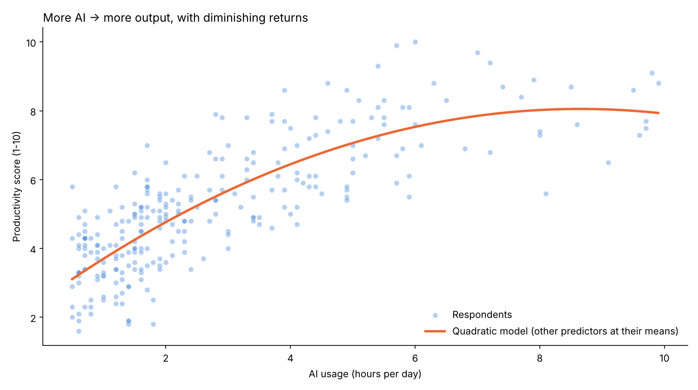
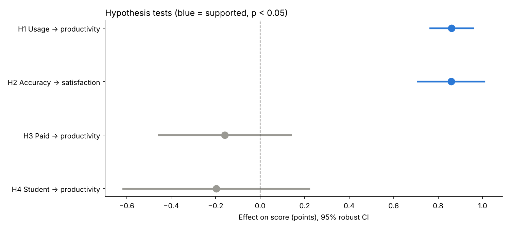

# Does More AI Mean More Output?

**Do people who use AI tools more actually get more done — and what makes them satisfied with those tools?**

Using the Kaggle *AI Usage and Impact on Students & Professionals* survey dataset, this project combines statistical inference (robust OLS with hypothesis tests) and a 9-model machine-learning benchmark to explain self-reported productivity and satisfaction.

## Key findings

| Hypothesis | Result |
|---|---|
| **H1** More AI usage → higher productivity | ✅ **Supported**, with diminishing returns |
| **H2** Higher perceived accuracy → higher satisfaction | ✅ **Supported** (+0.86 points per accuracy point) |
| **H3** Paid vs. free tools → different productivity | ❌ Not supported |
| **H4** Students vs. professionals → different productivity | ❌ Not supported |

- **Diminishing returns:** the productivity gain from one more hour of AI use falls from about **1.1 points at 1 h/day to about 0.1 at 8 h/day**, levelling off near **8.6 h/day**.
- **Accuracy drives satisfaction** even after controlling for productivity, and the two are nearly uncorrelated.
- **Data quality mattered:** a single respondent reporting 23 hours of AI use per day pushed linear cross-validated R² below zero. Treating implausible values as missing raised it to **0.53**; the final quadratic model reaches **0.58**.
- **Simple models won:** across a 9-model benchmark, the interpretable quadratic regression had the best test-set fit for productivity (test R² 0.63), and plain linear regression was effectively tied for best on satisfaction (test R² 0.72), ahead of random forest, gradient boosting, SVR, KNN and a neural net. Permutation importance agreed with the OLS conclusions.





## Approach

1. **Cleaning** — de-duplication, numeric parsing, standardising inconsistent categories (e.g. "Chat GPT", "chatgpt" → "ChatGPT"), implausible values set to missing rather than dropping rows.
2. **EDA** — distributions, correlations, group comparisons by user type, purpose, tool and paid vs. free.
3. **Statistical inference** — OLS with heteroskedasticity-robust (HC3) standard errors, mean-centred quadratic usage term, joint Wald tests, interaction tests and extra controls.
4. **Diagnostics** — Breusch-Pagan, Shapiro-Wilk, VIF, Cook's distance; Welch t-tests, ANOVA and Kruskal-Wallis.
5. **ML benchmark** — linear, quadratic, ridge, lasso, random forest, gradient boosting, SVR, KNN and neural network, tuned with GridSearchCV on shuffled 5-fold CV and evaluated once on a held-out test set.

## Results workbook

`results_workbook.xlsx` collects every result in one place: hypothesis verdicts, full OLS coefficient tables, the 9-model comparison with tuned hyperparameters, permutation importance, diagnostics, a cleaning log, and an **interactive usage calculator** — type in hours of AI use per day to get predicted productivity and the marginal gain of one more hour.

## Limitations
Synthetic, self-reported, cross-sectional data — results are associations, not causal effects.

## How to run

```bash
pip install -r requirements.txt
```

Download `AI_Usage_and_Impact_on_Students_and_Professionals.csv` from Kaggle, place it in this folder, and run `ai_usage_productivity_analysis.ipynb`. Set `APPLY_POST_POC_FIXES = False` to reproduce the original proof-of-concept results.

## Tools
Python · pandas · statsmodels · SciPy · scikit-learn · Matplotlib

---
*Group project (Group 3) for MGSC 661, Master of Management in Analytics, McGill University — with Daniel Puente, Katerina Avvakumova and François-Xavier Charbonneau.*
